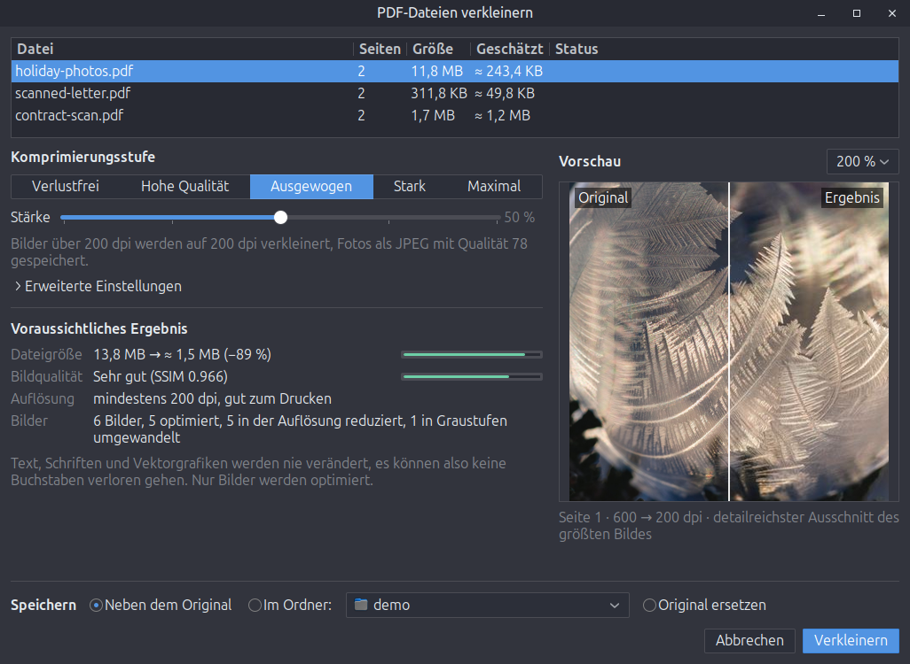
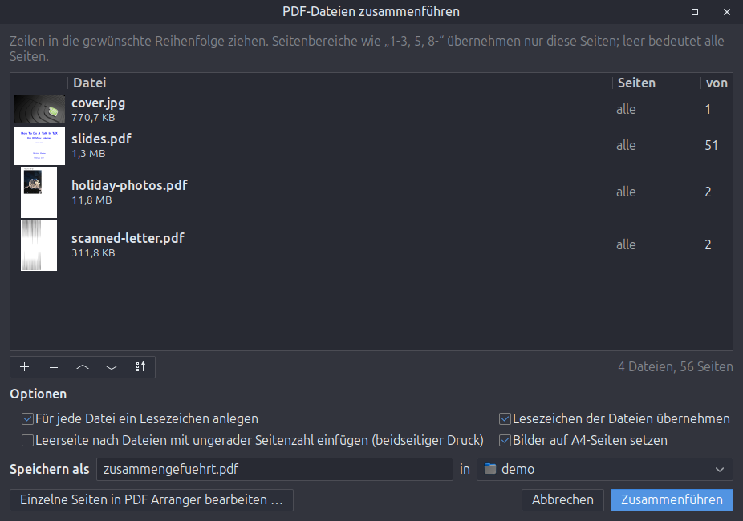
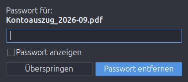

# nemo-actions-pdf-tools

*[English version](README.md)*

PDF-Werkzeuge für das Rechtsklick-Menü des Dateimanagers Nemo (Linux Mint / Cinnamon).
Alle Werkzeuge liegen in einem aufgeräumten Untermenü **PDF-Dateien ▸**, das nur bei PDFs und Bildern erscheint:

```
PDF-Dateien ▸  Verkleinern …
               Zusammenführen …                 (ab zwei PDFs)
               Teilen oder Seiten herauslösen …
               Drehen ▸  90° im Uhrzeigersinn / 90° gegen den Uhrzeigersinn / 180°
               Als Bilder exportieren …
               ─────────
               Mit Passwort schützen …
               Passwort entfernen …
               ─────────
               Seiten in PDF Arranger bearbeiten   (falls installiert)

Bilder ▸ PDF-Dateien ▸ PDF aus Bildern erstellen …
```



| Werkzeug | Was es tut | Code |
| --- | --- | --- |
| [Verkleinern](#verkleinern) | Macht PDFs kleiner, ohne je Text oder Schriften anzufassen, mit Live-Vorschau | [compress.py](nemo_pdf_tools/compress.py), [images.py](nemo_pdf_tools/images.py), [Dialog](nemo_pdf_tools/compress_window.py) |
| [Zusammenführen](#zusammenführen) | Fügt PDFs und Bilder in beliebiger Reihenfolge zusammen, mit Seitenbereichen und Lesezeichen | [operations.py](nemo_pdf_tools/operations.py), [Dialog](nemo_pdf_tools/merge_window.py) |
| [Teilen oder Seiten herauslösen](#teilen-oder-seiten-herauslösen) | Einzelseiten, gleich große Teile, Seitenbereiche oder Kapitel | [operations.py](nemo_pdf_tools/operations.py), [Dialog](nemo_pdf_tools/dialogs.py) |
| [Drehen](#drehen) | Dreht alle Seiten direkt in der Datei, verlustfrei | [operations.py](nemo_pdf_tools/operations.py) |
| [Als Bilder exportieren](#als-bilder-exportieren) | Seiten als PNG/JPEG oder die enthaltenen Bilder in Originalqualität | [operations.py](nemo_pdf_tools/operations.py), [Dialog](nemo_pdf_tools/dialogs.py) |
| [Mit Passwort schützen](#passwörter-setzen-und-entfernen) | AES-256-verschlüsselte Kopie, wahlweise mit Einschränkungen | [operations.py](nemo_pdf_tools/operations.py), [Dialog](nemo_pdf_tools/dialogs.py) |
| [Passwort entfernen](#passwörter-setzen-und-entfernen) | Ungeschützte Kopie, eine Abfrage für einen ganzen Stapel | [dialogs.py](nemo_pdf_tools/dialogs.py) |
| [PDF Arranger](#pdf-arranger) | Übergibt die Dateien zum Bearbeiten einzelner Seiten | [Erweiterung](extension/nemo-pdf-tools.py) |

Dieses Projekt hieß früher *nemo-actions-pdf-unprotect* und konnte nur Passwörter entfernen; dieses Werkzeug ist jetzt ein Eintrag der Sammlung.

## Verkleinern

Werkzeuge auf Ghostscript-Basis rendern das ganze Dokument neu – daher fehlen danach mitunter Buchstaben oder der Text wird unscharf.
Dieses Werkzeug arbeitet stattdessen wie „Dateigröße reduzieren“ in Acrobat: **Text, Schriften und Vektorgrafiken werden nie verändert**, optimiert werden nur Bilder und die Dateistruktur.

- **Fünf Stufen oder ein freier Regler** von *Verlustfrei* bis *Maximal*. Unter *Erweiterte Einstellungen* lassen sich Zielauflösung und JPEG-Qualität direkt einstellen.
- **Live-Schätzung beim Verschieben des Reglers**: erwartete Dateigröße, Bildqualität (SSIM, ein Maß dafür, wie ähnlich das Ergebnis aussieht), niedrigste verbleibende Auflösung und was mit wie vielen Bildern passiert. Große Dokumente werden anhand einer Stichprobe ihrer Bilder geschätzt, die Werte erscheinen also binnen einer Sekunde.
- **Vorher/Nachher-Vorschau**: der detailreichste Ausschnitt des größten Bildes bei 100, 200 oder 400 % Zoom, mit verschiebbarer Trennlinie.
- **Visuelle Prüfung**: Danach wird jede geänderte Seite gerendert und mit dem Original verglichen. Bilder, die eine Seite sichtbar verändern würden, bleiben unverändert; sieht trotzdem etwas falsch aus, wird nur verlustfrei optimiert.
- Speichert neben dem Original (`name_verkleinert.pdf`), in einem gewählten Ordner oder ersetzt das Original (das in den Papierkorb wandert). Wäre das Ergebnis nicht kleiner, wird nichts geschrieben.

| Stufe | Bilder verkleinert ab | JPEG-Qualität | Geeignet für |
| --- | --- | --- | --- |
| Verlustfrei | – | – | identischen Inhalt |
| Hohe Qualität | 300 dpi | 88 | Druck |
| Ausgewogen | 200 dpi | 78 | Bildschirm und Bürodruck |
| Stark | 144 dpi | 62 | Bildschirm und E-Mail |
| Maximal | 96 dpi | 45 | kleinste Dateien |

Was dabei im Hintergrund passiert:

- Die tatsächliche Auflösung jedes Bildes wird daraus berechnet, wie groß es auf der Seite gezeichnet wird. So werden nur Bilder verkleinert, die das Ziel wirklich überschreiten.
- Verlustfreie Schritte, auf jeder Stufe: maximale Flate-Kompression mit PNG-Prädiktoren, CCITT G4 für Schwarz-Weiß-Scans, Graustufen für Farbbilder ohne echte Farbe, Zusammenlegen identischer Bilder, Objekt-Streams sowie das Entfernen von Seiten-Vorschaubildern und internen Editor-Daten.
- JPEGs, die schon auf oder unter der Zielqualität liegen, werden nicht neu kodiert, denn das brächte nur zusätzliche Artefakte.
- Scans mit farbigem Stempel oder farbiger Unterschrift bleiben farbig.
- Bilder mit indizierten Farben, JBIG2, CCITT, 16 Bit und Sonderfarbräumen (Separation, DeviceN, Lab) bleiben unangetastet.
- Bei signierten PDFs und PDF/A-Dateien erscheint ein Hinweis, denn jede Änderung macht eine Signatur ungültig.

## Zusammenführen



- Zeilen per Ziehen sortieren, oder mit den Pfeiltasten und dem Sortiermenü (Name, Datum).
- Seitenbereiche je Datei, etwa `1-3, 5, 8-` oder `-2`; `5-1` läuft rückwärts.
- Bilder (JPEG, PNG, TIFF, …) lassen sich dazwischen einfügen. JPEGs werden ohne Neukodierung übernommen, Bilder auf Wunsch auf A4-Seiten gesetzt.
- Ein Lesezeichen pro Datei, die eigenen Lesezeichen der Dateien bleiben erhalten.
- Wahlweise eine Leerseite nach Dateien mit ungerader Seitenzahl, für beidseitigen Druck.
- Danach: Ergebnis öffnen, im Ordner zeigen oder direkt an *Verkleinern* weitergeben.
- *Einzelne Seiten in PDF Arranger bearbeiten …* öffnet die Dateien in der gewählten Reihenfolge in [PDF Arranger](https://github.com/pdfarranger/pdfarranger).

Sind nur Bilder ausgewählt, erscheint derselbe Dialog als **PDF aus Bildern erstellen …**.

## Teilen oder Seiten herauslösen

Aufteilen in Einzelseiten, in Teile zu *n* Seiten, nach Seitenbereichen (`1-3; 4-10; 11-`, eine Datei je Bereich) oder an den obersten Lesezeichen (eine Datei je Kapitel). Zum Herauslösen von Seiten einen einzigen Bereich angeben. Der Dialog zeigt, wie viele Dateien entstehen; ein Unterordner pro Datei ist wählbar.

## Drehen

Dreht alle Seiten um 90° im oder gegen den Uhrzeigersinn oder um 180°. Geändert wird nur die Drehangabe jeder Seite – das geht sofort und verlustfrei. Signierte PDFs werden abgelehnt.

## Als Bilder exportieren

- **Seiten als Bilder**: PNG oder JPEG mit 72, 150, 300 oder 600 dpi, wahlweise nur bestimmte Seiten.
- **Enthaltene Bilder**: speichert die Bilder aus der PDF in ihrem Originalformat und ihrer Originalqualität, ohne neu zu rendern.

## Passwörter setzen und entfernen

- **Mit Passwort schützen …** speichert eine AES-256-verschlüsselte Kopie (`name_geschuetzt.pdf`). Drucken, Kopieren und Bearbeiten lassen sich verbieten; ein separates, zufälliges Besitzerpasswort verhindert dann, dass die Einschränkungen mit dem Öffnen-Passwort aufgehoben werden.


- **Passwort entfernen …** speichert eine ungeschützte Kopie (`name_ungeschuetzt.pdf`). Ein Passwort, das gepasst hat, wird bei den nächsten Dateien automatisch probiert – ein Stapel Kontoauszüge braucht also nur eine Abfrage. PDFs mit reinem Besitzerpasswort (Druck-/Kopiersperre) werden ohne Nachfrage entsperrt.

Originale werden nie verändert, vorhandene Dateien nie überschrieben (stattdessen wird `-2`, `-3`, … angehängt).

## PDF Arranger

Zum Bearbeiten einzelner Seiten (umsortieren, drehen, löschen) werden die Dateien an PDF Arranger übergeben, der das sehr gut kann – ein Nachbau lohnt nicht. Der Eintrag erscheint nur, wenn `pdfarranger` installiert ist (`sudo apt install pdfarranger`).

## Updates

Wenn ein Werkzeug-Fenster öffnet, prüfen die Werkzeuge im Hintergrund **höchstens einmal am Tag**, ob es eine neuere Version gibt (eine anonyme Anfrage an die GitHub-API, 5 s Zeitlimit). Beim Rechtsklick läuft nichts, und im Hintergrund bleibt nichts im Speicher. Gibt es ein Update, bietet eine Leiste *Jetzt aktualisieren* oder *Später* an (fragt nach 7 Tagen erneut).

```bash
pdf-tools update
```

```bash
pdf-tools update --auto off
```

Der erste Befehl prüft und installiert sofort; der zweite schaltet die automatische Prüfung ab (`--auto on` schaltet sie wieder ein).

## Voraussetzungen

Unter Linux Mint 22 vorinstalliert:

- `nemo-python` (das Untermenü)
- `python3-pikepdf` (PDF-Verarbeitung, basiert auf qpdf)
- `python3-pil`, `python3-numpy` (Bildverarbeitung)
- `python3-img2pdf` (Bilder zu PDF)
- `gir1.2-poppler-0.18` (Vorschauen, visuelle Prüfung, Seitenexport)
- `python3-gi` mit GTK 3
- `gettext` (nur für den Installer, um die Übersetzungen zu erzeugen)

Fehlende Pakete nennt der Installer.

## Installation

```bash
git clone https://github.com/SoulInfernoDE/nemo-actions-pdf-tools.git
```

```bash
cd nemo-actions-pdf-tools && ./install.sh
```

Danach Nemo einmal neu starten:

```bash
nemo -q
```

Alles wird nur für den aktuellen Benutzer installiert: das Programm nach `~/.local/share/nemo-pdf-tools/`, die Menü-Erweiterung nach `~/.local/share/nemo-python/extensions/`, die Übersetzungen nach `~/.local/share/locale/` und der Befehl `pdf-tools` nach `~/.local/bin/`. Eine vorher installierte, eigenständige Aktion *PDF-Passwort entfernen* wird ersetzt.

Zum Entfernen:

```bash
./install.sh --uninstall
```

## Kommandozeile

Die Menüeinträge rufen `pdf-tools BEFEHL --gui DATEIEN` auf. Ohne `--gui` funktionieren einige Befehle auch im Terminal:

```bash
pdf-tools compress --strength 50 scan.pdf
```

```bash
pdf-tools merge -o alle.pdf a.pdf b.pdf c.pdf
```

```bash
pdf-tools rotate --angle 90 quer.pdf
```

## Übersetzungen

Englisch und Deutsch, je nach Systemsprache. Für eine weitere Sprache deren Kürzel in `po/LINGUAS` eintragen, `po/<kürzel>.po` aus `po/nemo-pdf-tools.pot` anlegen und nach Textänderungen `po/update-pot.sh` ausführen.

## Entwicklung

`tests/make_samples.py` erzeugt Test-PDFs (Fotos, Schwarz-Weiß-Scans, als Farbe gespeicherte Graustufen-Scans, CMYK, invertiertes CMYK im Photoshop-Stil, Soft- und Stencil-Masken, Duplikate). `tests/run_compress.py` komprimiert sie auf mehreren Stufen und vergleicht jedes Ergebnis mit dem Original, indem es beide mit einem unabhängigen Renderer (`pdftoppm`) rendert.

```bash
/usr/bin/python3 tests/make_samples.py /tmp/samples && /usr/bin/python3 tests/run_compress.py /tmp/samples /tmp/out 0 50 100
```

## Lizenz

MIT, siehe [LICENSE](LICENSE).
