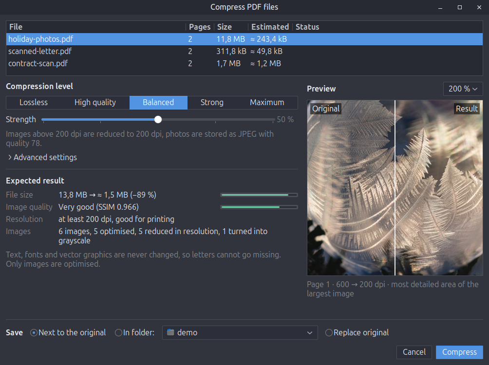
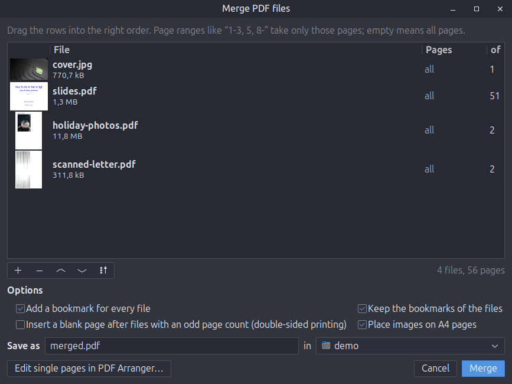

# nemo-actions-pdf-tools

*[Deutsche Fassung](README.de.md)*

PDF tools for the right-click menu of the Nemo file manager (Linux Mint / Cinnamon).
All tools sit in one tidy submenu, **PDF files ▸**, which only appears for PDFs and images:

```
PDF files ▸  Compress…
             Merge…                          (two or more PDFs)
             Split or extract pages…
             Rotate ▸  90° clockwise / 90° counter-clockwise / 180°
             Export as images…
             ─────────
             Protect with password…
             Remove password…
             ─────────
             Edit pages in PDF Arranger      (if installed)

Images ▸ PDF files ▸ Create PDF from images…
```



| Tool | What it does | Code |
| --- | --- | --- |
| [Compress](#compress) | Makes PDFs smaller without ever touching text or fonts, with a live preview | [compress.py](nemo_pdf_tools/compress.py), [images.py](nemo_pdf_tools/images.py), [dialog](nemo_pdf_tools/compress_window.py) |
| [Merge](#merge) | Combines PDFs and images in any order, with page ranges and bookmarks | [operations.py](nemo_pdf_tools/operations.py), [dialog](nemo_pdf_tools/merge_window.py) |
| [Split or extract pages](#split-or-extract-pages) | Single pages, fixed-size parts, page ranges or chapters | [operations.py](nemo_pdf_tools/operations.py), [dialog](nemo_pdf_tools/dialogs.py) |
| [Rotate](#rotate) | Rotates all pages in place, losslessly | [operations.py](nemo_pdf_tools/operations.py) |
| [Export as images](#export-as-images) | Pages as PNG/JPEG, or the embedded images in original quality | [operations.py](nemo_pdf_tools/operations.py), [dialog](nemo_pdf_tools/dialogs.py) |
| [Protect with password](#protect-and-remove-passwords) | AES-256 encrypted copy with optional restrictions | [operations.py](nemo_pdf_tools/operations.py), [dialog](nemo_pdf_tools/dialogs.py) |
| [Remove password](#protect-and-remove-passwords) | Unprotected copy, one prompt for a whole batch | [dialogs.py](nemo_pdf_tools/dialogs.py) |
| [PDF Arranger](#pdf-arranger) | Hands the files over for editing single pages | [extension](extension/nemo-pdf-tools.py) |

This project was called *nemo-actions-pdf-unprotect* and only removed passwords; that tool is now one entry of the suite.

## Compress

Ghostscript-based shrinkers re-render the whole document, which is how letters go missing and text turns blurry.
This tool works like Acrobat's "Reduce file size" instead: **text, fonts and vector graphics are never changed**, only images and the file structure are optimised.

- **Five levels or a free slider** from *Lossless* to *Maximum*. Under *Advanced settings* the target resolution and JPEG quality can be set directly.
- **Live estimate while you move the slider**: expected file size, image quality (SSIM, a measure of how similar the result looks), lowest remaining resolution and what happens to how many images. Large documents are estimated from a sample of their images, so the numbers appear within a second.
- **Before/after preview**: the most detailed spot of the largest image at 100, 200 or 400 % zoom, with a divider you can drag.
- **Visual check**: afterwards every changed page is rendered and compared with the original. Images that would change a page visibly are left as they were, and if anything still looks wrong, only lossless optimisation is used.
- Saves next to the original (`name_compressed.pdf`), into a chosen folder, or replaces the original (which goes to the trash). Nothing is written if the result would not be smaller.

| Level | Images reduced above | JPEG quality | Good for |
| --- | --- | --- | --- |
| Lossless | – | – | identical content |
| High quality | 300 dpi | 88 | printing |
| Balanced | 200 dpi | 78 | screen and office printing |
| Strong | 144 dpi | 62 | screen and e-mail |
| Maximum | 96 dpi | 45 | smallest files |

What happens under the hood:

- The effective resolution of every image is calculated from how large it is drawn on the page, so only images that really exceed the target are reduced.
- Lossless steps, used at every level: maximum Flate compression with PNG predictors, CCITT G4 for black-and-white scans, gray conversion of colour images that contain no colour, merging of identical images, object streams, and removal of page thumbnails and private editor data.
- JPEGs that are already at or below the target quality are not re-encoded, because that would only add artefacts.
- Scans with a coloured stamp or signature stay in colour.
- Indexed-colour, JBIG2, CCITT, 16-bit and special colour space images (Separation, DeviceN, Lab) are left untouched.
- Signed PDFs and PDF/A files get a warning, since any change invalidates a signature.

## Merge



- Drag rows into order, or use the arrow buttons and the sort menu (name, date).
- Page ranges per file, such as `1-3, 5, 8-` or `-2`; `5-1` runs backwards.
- Images (JPEG, PNG, TIFF, …) can be mixed in. JPEGs are embedded without re-encoding, and images can be fitted onto A4 pages.
- A bookmark per file, and the files' own bookmarks are kept.
- Optional blank page after files with an odd page count, for double-sided printing.
- Afterwards: open the result, show it in the folder, or pass it straight on to *Compress*.
- *Edit single pages in PDF Arranger…* opens the files in the chosen order in [PDF Arranger](https://github.com/pdfarranger/pdfarranger).

With only images selected, the same dialog is offered as **Create PDF from images…**.

## Split or extract pages

Split into single pages, into parts of *n* pages, by page ranges (`1-3; 4-10; 11-`, one file per range), or at the top-level bookmarks (one file per chapter). To extract pages, enter a single range. The dialog shows how many files will be created; a subfolder per file is optional.

## Rotate

Rotates all pages by 90° clockwise, 90° counter-clockwise or 180°. Only the rotation entry of each page changes, so it is instant and lossless. Signed PDFs are refused.

## Export as images

- **Pages as images**: PNG or JPEG at 72, 150, 300 or 600 dpi, optionally only some pages.
- **Embedded images**: saves the images inside the PDF in their original format and quality, without re-rendering.

## Protect and remove passwords

- **Protect with password…** saves an AES-256 encrypted copy (`name_protected.pdf`). Printing, copying and editing can be forbidden; a separate random owner password then keeps the restrictions from being lifted with the open password.


- **Remove password…** saves an unprotected copy (`name_unprotected.pdf`). A password that worked is tried on the next files automatically, so a batch of statements needs only one prompt. PDFs with only an owner password (printing/copying restrictions) are unlocked without asking.

Originals are never modified, and existing files are never overwritten (`-2`, `-3`, … is appended instead).

## PDF Arranger

For editing single pages (reordering, rotating or deleting) the files are handed over to PDF Arranger, which does this job very well; there is no point in rebuilding it. The entry appears only if `pdfarranger` is installed (`sudo apt install pdfarranger`).

## Updates

When a tool window opens, the tools check at most **once a day** in the background whether a newer release exists (one anonymous request to the GitHub API, 5 s timeout). Nothing runs on right-click and nothing stays in memory. If there is an update, a bar offers *Update now* or *Later* (asks again after 7 days).

```bash
pdf-tools update
```

```bash
pdf-tools update --auto off
```

The first command checks and installs right away; the second turns the automatic check off (`--auto on` turns it back on).

## Requirements

Preinstalled on Linux Mint 22:

- `nemo-python` (the submenu)
- `python3-pikepdf` (PDF handling, based on qpdf)
- `python3-pil`, `python3-numpy` (image processing)
- `python3-img2pdf` (images to PDF)
- `gir1.2-poppler-0.18` (previews, visual check, page export)
- `python3-gi` with GTK 3
- `gettext` (only needed by the installer to build the translations)

The installer names any missing package.

## Installation

```bash
git clone https://github.com/SoulInfernoDE/nemo-actions-pdf-tools.git
```

```bash
cd nemo-actions-pdf-tools && ./install.sh
```

Then restart Nemo once:

```bash
nemo -q
```

Everything is installed for the current user only: the program to `~/.local/share/nemo-pdf-tools/`, the menu extension to `~/.local/share/nemo-python/extensions/`, translations to `~/.local/share/locale/`, and the `pdf-tools` command to `~/.local/bin/`. A previously installed standalone *Remove PDF password* action is replaced.

To remove it:

```bash
./install.sh --uninstall
```

## Command line

The menu entries call `pdf-tools COMMAND --gui FILES`. Without `--gui`, some commands also work in a terminal:

```bash
pdf-tools compress --strength 50 scan.pdf
```

```bash
pdf-tools merge -o all.pdf a.pdf b.pdf c.pdf
```

```bash
pdf-tools rotate --angle 90 sideways.pdf
```

## Translations

English and German, picked from the system language. To add a language, add its code to `po/LINGUAS`, create `po/<code>.po` from `po/nemo-pdf-tools.pot`, and run `po/update-pot.sh` after changing texts.

## Development

`tests/make_samples.py` builds test PDFs (photos, black-and-white scans, gray scans stored as colour, CMYK, Photoshop-style inverted CMYK, soft and stencil masks, duplicates). `tests/run_compress.py` compresses them at several levels and compares every result with the original by rendering it with an independent renderer (`pdftoppm`).

```bash
/usr/bin/python3 tests/make_samples.py /tmp/samples && /usr/bin/python3 tests/run_compress.py /tmp/samples /tmp/out 0 50 100
```

## License

MIT, see [LICENSE](LICENSE).
