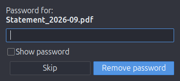

# nemo-actions-pdf-unprotect

*[Deutsche Fassung](README.de.md)*

Adds **Remove PDF password** to the right-click menu of PDF files in the Nemo file manager (Linux Mint / Cinnamon).
You enter the password once, and an unprotected copy is saved next to the original:

```
Invoice.pdf  →  Invoice_unprotected.pdf
```



## Features

- Works on one or many selected PDFs. A password that worked is tried automatically on the next files, so a batch of statements with the same password needs only one prompt.
- Wrong password: the prompt asks again; **Skip** leaves that file alone.
- PDFs that only carry an owner password (printing/copying restrictions) are unlocked without asking.
- Never overwrites anything: if `…_unprotected.pdf` already exists, `…_unprotected-2.pdf` is used. The original stays untouched.
- The password is never passed on a command line, so it does not show up in the process list.
- English and German user interface, picked from your system language.

## Requirements

Preinstalled on Linux Mint 22:

- `python3-pikepdf` (PDF handling, based on qpdf)
- `python3-gi` with GTK 3 (password dialog)
- `libnotify-bin` (success notification, optional)
- `gettext` (only needed by the installer to build the translations)

```bash
sudo apt install python3-pikepdf python3-gi gettext
```

## Installation

```bash
./install.sh
```

This copies the action to `~/.local/share/nemo/actions/` and the translations to `~/.local/share/locale/`.
Nemo picks up the new menu entry immediately; if not, run `nemo -q` and open Nemo again.

Uninstall:

```bash
./install.sh --uninstall
```

## Translations

User-visible texts live in `po/`. After changing texts in the code, refresh the catalogs:

```bash
po/update-pot.sh
```

To add a language, create `po/<lang>.po` from `po/pdf-password-remover.pot` (e.g. with `msginit`) and add the language code to `po/LINGUAS`.

## Credits

Base script idea by Alfcx. Thank you for providing the base idea.

## License

[MIT](LICENSE)
